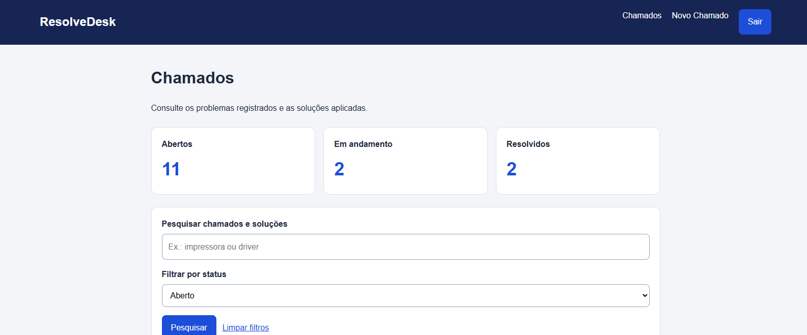
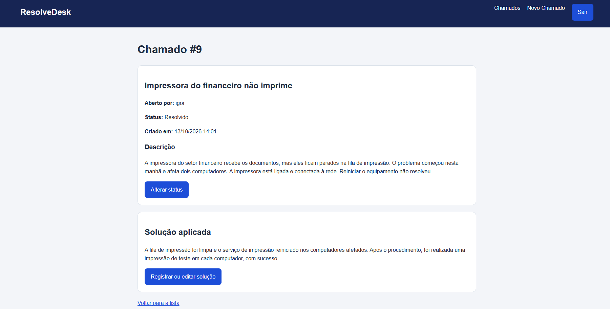

# ResolveDesk

[](https://github.com/JazzyJeff6/resolvedesk/actions/workflows/testes.yml)

Sistema web de chamados de suporte técnico desenvolvido com Python e Django.

O projeto permite registrar problemas, consultar chamados e acompanhar o andamento do atendimento. Está sendo desenvolvido como projeto de portfólio, com evolução gradual das funcionalidades.

## Demonstração online

Acesse: [ResolveDesk](https://resolvedesk-ak2f.onrender.com/)

A demonstração utiliza dados fictícios e exige login.

A hospedagem usa o plano gratuito do Render. Após um período sem
acessos, a primeira abertura pode levar cerca de um minuto.

### Acesso de demonstração

- **Usuário:** `cliente_demo`
- **Senha:** `teste_123`

Essa conta permite somente consultar seus chamados fictícios,
status e soluções. Cadastro e edição estão bloqueados.

As contas técnicas e administrativas não são disponibilizadas
ao público.

## Funcionalidades disponíveis

- Resumo com a quantidade de chamados abertos, em andamento e resolvidos.
- Filtro por status combinado com pesquisa por texto.
- Paginação com até treze chamados por página, preservando os filtros.
- Abertura de chamados com título e descrição.
- Listagem dos chamados, do mais recente para o mais antigo.
- Página de detalhes de cada chamado.
- Registro automático da data de criação.
- Atualização do status: Aberto, Em andamento e Resolvido.
- Registro e edição da solução aplicada.
- Pesquisa por texto no título, na descrição e na solução.
- Login e logout de usuários.
- Exigência de autenticação para acessar os chamados.
- Associação automática de novos chamados ao usuário que os abriu.
- Clientes acessam somente os próprios chamados.
- Técnicos e administradores consultam todos os chamados e podem
- atualizar status e registrar soluções.
- Verificação de permissões no backend, inclusive no acesso direto às URLs.

## Tecnologias

- Python
- Django
- SQLite
- HTML com templates do Django
- Git e GitHub

## Telas do sistema

### Lista de chamados

Pesquisa e consulta dos chamados disponíveis para o usuário.



### Detalhes do chamado

Informações do atendimento, status e solução aplicada.
As opções de edição são exibidas para técnicos e administradores.



## Como executar no Windows

Os comandos abaixo devem ser executados no Prompt de Comando (CMD).
É necessário ter Python e Git instalados.

### 1. Clonar o repositório

```bat
git clone https://github.com/JazzyJeff6/resolvedesk.git
cd resolvedesk
```

### 2. Criar e ativar o ambiente virtual

```bat
python -m venv .venv
.venv\Scripts\activate.bat
```

### 3. Instalar as dependências

```bat
python -m pip install -r requirements.txt
```

### 4.Configurar o ambiente de desenvolvimento

No Prompt de Comando (CMD), gere uma chave local:

```bat
python -c "import secrets; print(secrets.token_urlsafe(50))"
```

Substitua `SUA_CHAVE` pelo resultado e execute:

```bat
set DJANGO_SECRET_KEY=SUA_CHAVE
set DJANGO_DEBUG=True
```

Essas variáveis valem apenas para o terminal atual. Configure-as
novamente ao abrir outro terminal, antes de executar comandos do Django.

Não publique a chave no repositório. A produção deve utilizar
uma chave própria e manter `DJANGO_DEBUG=False`.

### 5. Preparar o banco de dados

```bat
python manage.py migrate
```

### 6.Criar uma conta administradora

```bat
python manage.py createsuperuser
```

Depois de iniciar o servidor, entre com essa conta em:

http://127.0.0.1:8000/admin/

No painel administrativo, é possível criar usuários e grupos:

- **Cliente:** usuário ativo, sem privilégios administrativos e fora
  do grupo `Tecnicos`.
- **Técnico:** usuário ativo pertencente ao grupo `Tecnicos`.
  Não precisa ser staff ou superusuário.
- **Administrador:** conta criada com `createsuperuser`.

O nome do grupo deve ser exatamente `Tecnicos`, sem acento.


### 7. Iniciar o servidor de desenvolvimento

```bat
python manage.py runserver
```

Acesse a lista de chamados em:

http://127.0.0.1:8000/chamados/

O banco de dados local é criado pelas migrações e começa sem chamados.
O servidor utilizado nesta etapa é destinado ao desenvolvimento local.

## Testes automatizados

Com o ambiente virtual ativo e as dependências instaladas, execute:

```bat
python manage.py test chamados
```

Os testes verificam:

- Contadores por status respeitando o autor e mantendo os totais durante a busca.
- Combinação de busca e filtro por status com restrição de acesso.
- Paginação respeitando os chamados permitidos para o usuário.
- Redirecionamento de visitantes sem login.
- Bloqueio do acesso de um cliente ao chamado de outro usuário.
- Bloqueio da alteração de status e solução por clientes.
- Permissão para técnicos alterarem status e solução.
- Preservação do autor quando o técnico registra uma solução.
- Associação do novo chamado ao usuário logado, com status inicial Aberto.
- Listagem restrita aos chamados do próprio cliente.
- Pesquisa por solução respeitando o acesso aos chamados do cliente.

O Django utiliza um banco temporário durante os testes, separado
do banco de desenvolvimento.

## Próximas etapas

- Melhorias na interface com CSS.
- Biblioteca dedicada de soluções.
- Sugestões de soluções por semelhança entre chamados.

## Autor

Desenvolvido por Igor Delmasquio.

GitHub: https://github.com/JazzyJeff6